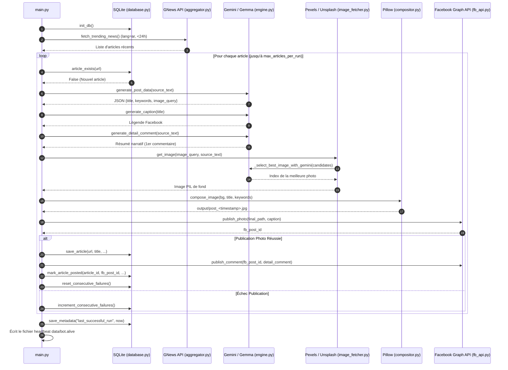
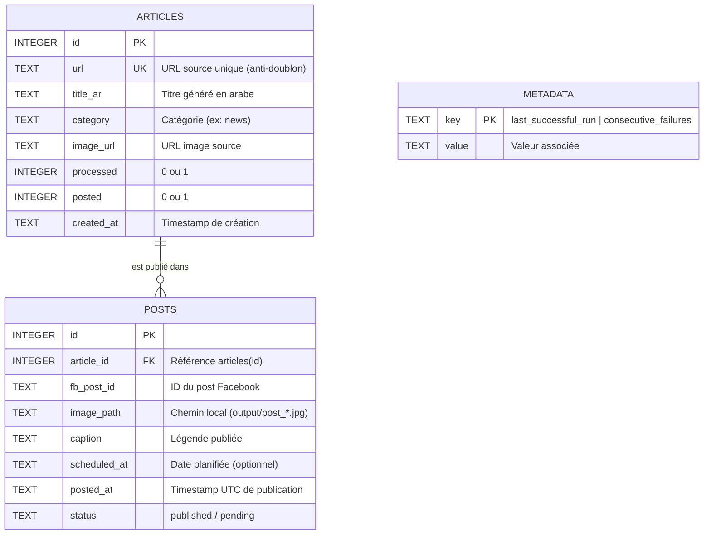

# 🔄 Architecture & Pipeline de Fonctionnement — Screen Drop Bot

Ce document détaille le fonctionnement interne du bot, le flux de données étape par étape, les mécanismes de résilience et le schéma de base de données sous forme de diagrammes **Mermaid**.

---

## 1. Vue d'ensemble du Pipeline (Flowchart)

```mermaid
flowchart TD
    %% Point d'entrée
    CLI["🚀 Lancement : python main.py"] --> MODE{"Mode d'exécution ?"}
    MODE -- "--once (ou défaut)" --> RUN["run_full_pipeline()"]
    MODE -- "--schedule" --> SCHED["start_scheduler() (APScheduler)"]

    %% Scheduler & Rattrapage
    SCHED --> CATCHUP{"Retard > 1.5x intervalle ?"}
    CATCHUP -- "Oui (max 3 runs)" --> RUN
    CATCHUP -- "Non / Après rattrapage" --> CRON["⏰ CronTrigger (8h, 10h, 12h, 14h, 16h, 18h, 20h, 22h)"]
    CRON --> RUN

    %% 1. Collecte
    RUN --> DB_INIT["🗄️ init_db() (SQLite WAL)"]
    DB_INIT --> GNEWS["📡 fetch_trending_news()<br/>API GNews (lang=ar, < 24h)"]

    GNEWS --> HAS_NEWS{"Articles trouvés ?"}
    HAS_NEWS -- "Non / Erreur API" --> ERR_CHECK["⚠️ increment_consecutive_failures()<br/>Si >= 3 : écrit data/bot.alert"]
    HAS_NEWS -- "Oui" --> LOOP["🔄 Boucle sur les articles"]

    %% 2. Déduplication
    LOOP --> DEDUP{"article_exists(url)<br/>dans SQLite ?"}
    DEDUP -- "Oui (déjà traité)" --> LOOP
    DEDUP -- "Non (nouveau)" --> AI_ENGINE

    %% 3. Moteur IA
    subgraph AI_ENGINE ["🧠 Moteur IA — ContentEngine (gemma-4-31b-it)"]
        direction TB
        GEN_POST["1. generate_post_data()<br/>→ title (AR), keywords, image_query (EN)"]
        GEN_CAP["2. generate_caption()<br/>→ Légende FB + appel au commentaire"]
        GEN_COM["3. generate_detail_comment()<br/>→ Résumé narratif 'Snackable News'"]
        GEN_POST --> GEN_CAP --> GEN_COM
    end

    %% 4. Recherche Visuelle
    AI_ENGINE --> IMG_FETCH
    subgraph IMG_FETCH ["🔍 Recherche Visuelle — get_image()"]
        direction TB
        PEXELS["Pexels API (10 candidats)"] --> GEMINI_PICK["🤖 _select_best_image_with_gemini()<br/>Choix Directeur Artistique"]
        PEXELS -- "Échec / Vide" --> UNSPLASH["Unsplash API (5 candidats)"]
        UNSPLASH --> GEMINI_PICK
        UNSPLASH -- "Échec / Vide" --> FALLBACK["_generate_fallback_image()<br/>Dégradé sombre 1200x630"]
    end

    %% 5. Composition
    IMG_FETCH --> COMPOSITOR
    subgraph COMPOSITOR ["🎨 Composition — compose_image()"]
        direction TB
        CROP["Crop centré 1200x630 + Flou (0.8px)"] --> GRAD["Overlay Gradient Noir (bas → haut)"]
        GRAD --> RTL["Texte Arabe RTL (Cairo-Bold + libraqm)<br/>Blanc + Mots-clés en Jaune Doré (#FFD700)"]
        RTL --> WM["Watermark Logo (top-right)<br/>→ Sauvegarde output/post_timestamp.jpg"]
    end

    %% 6. Publication & Persistance
    COMPOSITOR --> FB_PHOTO["📤 publish_photo()<br/>Facebook Graph API (/photos)"]
    FB_PHOTO --> FB_OK{"Post FB réussi ?"}
    FB_OK -- "Non" --> ERR_CHECK
    FB_OK -- "Oui (fb_post_id)" --> SAVE_DB["💾 save_article() dans SQLite"]
    SAVE_DB --> FB_COMMENT["💬 publish_comment()<br/>1er commentaire détaillé (/comments)"]
    FB_COMMENT --> MARK_DONE["✅ mark_article_posted()<br/>reset_consecutive_failures()"]
    MARK_DONE --> HEARTBEAT["💓 Mise à jour last_successful_run<br/>& écriture data/bot.alive"]
```

---

## 2. Diagramme de Séquence (Exécution d'un Run)

Ce diagramme illustre les échanges entre l'orchestrateur (`main.py`), les modules internes et les APIs externes lors du traitement d'une actualité :

---

## 3. Détail étape par étape

### Étape 1 — Collecte & Filtrage (`modules/radar/aggregator.py`)
- **Source** : Endpoint `https://gnews.io/api/v4/top-headlines`.
- **Paramètres** : Langue arabe (`ar`), catégorie `general`, nombre max défini dans `config/settings.yaml`.
- **Fraîcheur** : Les articles publiés il y a plus de **24 heures** sont automatiquement écartés.

### Étape 2 — Déduplication (`modules/core/database.py`)
- Avant tout appel IA coûteux, `article_exists(url)` vérifie si l'URL de l'article est déjà présente dans la table `articles` de `data/bot_data.db`.
- L'article n'est enregistré en base (`save_article`) **qu'après** la réussite effective de la publication de la photo sur Facebook, afin de ne jamais bloquer un article dont la publication aurait échoué à cause d'une erreur réseau temporaire.

### Étape 3 — Moteur Éditorial IA (`modules/content/engine.py`)
- Utilise le SDK `google-genai` avec le modèle configuré dans `settings.yaml` (`gemma-4-31b-it`).
- Injecte l'identité de marque **Screen Drop** (ton direct, punchy, moderne, 18-35 ans) dans les prompts de `config/prompts.yaml`.
- **3 générations successives** (espacées de 3s pour éviter le rate-limiting, avec retry exponentiel `5s → 10s → 20s` sur erreurs `429`/`500`) :
  1. `generate_post_data()` : Retourne un JSON strict contenant le `title` (titre punchy en arabe), les `keywords` (mots-clés à surligner en jaune sur l'image) et l'`image_query` (mots-clés en anglais pour la banque d'images).
  2. `generate_caption()` : Génère une légende courte qui suscite la curiosité et invite à lire le premier commentaire.
  3. `generate_detail_comment()` : Rédige le résumé complet de l'actualité dans un style narratif fluide (« Snackable News »).

### Étape 4 — Recherche & Sélection d'Image par IA (`modules/visual/image_fetcher.py`)
- **Cascade de sources** :
  1. **Pexels API** : Récupère jusqu'à 10 photos au format paysage (`landscape`).
  2. **Unsplash API** (si Pexels échoue ou ne trouve rien) : Récupère jusqu'à 5 photos au format paysage.
  3. **Fallback procédural** (si aucune API ne répond) : Génère localement un fond dégradé sombre stylisé `1200×630 px`.
- **Direction Artistique IA** : `_select_best_image_with_gemini()` analyse les descriptions (`alt`) des photos candidates par rapport au sujet de l'article et sélectionne l'index de la photo la plus pertinente.

### Étape 5 — Composition Graphique RTL (`modules/visual/compositor.py`)
- **Format cible** : `1200×630 px` (ratio optimal Facebook).
- **Calques appliqués dans l'ordre** :
  1. Redimensionnement `LANCZOS` et recadrage centré (`crop`).
  2. Léger flou gaussien (`radius=0.8`) pour détacher le texte du fond.
  3. **Overlay Gradient Noir** : Dégradé vertical (puissance `2.2`, opacité max `225/255` en bas).
  4. **Typographie Arabe RTL** : Police `Cairo-Bold.ttf` avec support natif `libraqm` (ou fallback `arabic-reshaper` + `python-bidi`). Taille adaptative selon la longueur du titre, ombre portée, texte en blanc `#FFFFFF` et surlignage mot-à-mot des `keywords` en jaune doré `#FFD700`.
  5. **Watermark** : Superposition du logo `logo.png` en haut à droite (`top-right`), avec détection automatique de transparence ou masque de luminance.

### Étape 6 — Publication Facebook (`modules/publisher/fb_api.py`)
- **Mode test (`is_draft: true`)** : Simule les appels sans publier sur Facebook.
- **Mode production (`is_draft: false`)** :
  1. `publish_photo()` : Envoie l'image JPEG et la légende sur `POST /{page_id}/photos` et récupère le `fb_post_id`.
  2. `publish_comment()` : Publie immédiatement le résumé narratif en premier commentaire sur `POST /{fb_post_id}/comments`.

---

## 4. Schéma de la Base de Données (`data/bot_data.db`)

La base SQLite fonctionne en mode **WAL (Write-Ahead Logging)** pour garantir des performances optimales et éviter les verrous d'écriture.

---

## 5. Planification, Rattrapage & Monitoring

| Mécanisme | Fichier / Clé | Description |
| :--- | :--- | :--- |
| **Planification Cron** | `main.py` (`start_scheduler`) | Exécute le pipeline aux heures définies dans `publisher.posting_hours` (`8, 10, 12, 14, 16, 18, 20, 22`). |
| **Rattrapage (Catch-up)** | `metadata.last_successful_run` | Au lancement du scheduler, si le temps écoulé depuis le dernier run dépasse `1.5 × intervalle`, le bot lance jusqu'à **3 runs de rattrapage** immédiats (espacés de 30 secondes). |
| **Heartbeat** | `data/bot.alive` | Contient le timestamp ISO UTC de la dernière exécution terminée. Permet à un outil externe de vérifier que le bot est en vie. |
| **Alerte de panne** | `data/bot.alert` | Créé automatiquement lorsque `consecutive_failures` atteint **3 échecs consécutifs** (ex. panne d'API ou problème réseau). Remis à zéro dès qu'une publication réussit. |
