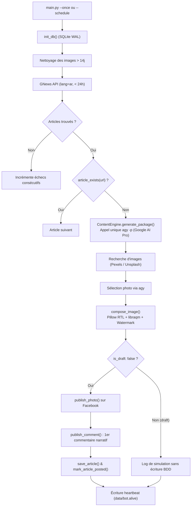
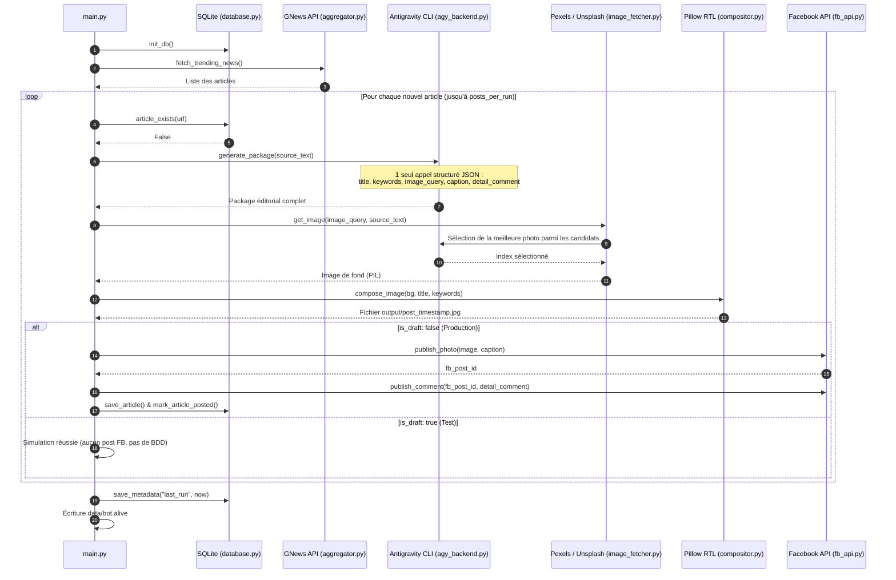
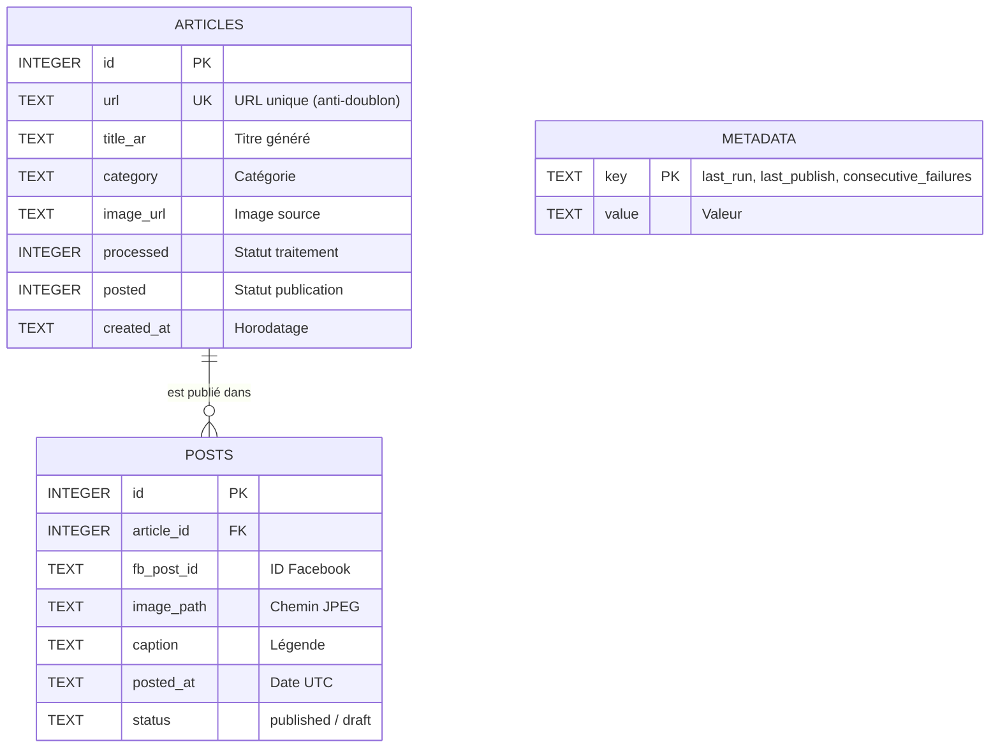

# 🔄 Pipeline de Fonctionnement — Screen Drop Bot

Architecture technique et flux d'exécution du bot Facebook.

---

## 1. Flowchart d'un Run

---

## 2. Diagramme de Séquence

---

## 3. Détail des étapes

### Étape 1 : Collecte GNews (`modules/radar/aggregator.py`)
- Requête sur `top-headlines` (arabe, catégorie `general`).
- Filtre strict : rejet automatique des articles datant de plus de 24h.

### Étape 2 : Déduplication (`modules/core/database.py`)
- Vérification de l'URL dans la table `articles`.
- En production, l'article n'est enregistré qu'après succès de la publication Facebook.

### Étape 3 : Rédaction unifiée `agy` (`modules/content/engine.py`)
- Exécute `agy -p` avec `--json-schema` et `--sandbox` (modèle `gemini-3.8-flash-medium`).
- Produit en un seul appel :
  - `title` : Titre court en arabe (≤ 10 mots).
  - `keywords` : 2 à 3 mots-clés du titre pour surlignage doré.
  - `image_query` : 1 ou 2 mots en anglais pour la banque d'images.
  - `caption` : Légende Facebook avec appel au premier commentaire.
  - `detail_comment` : Résumé narratif sans balises markdown.

### Étape 4 : Image & Composition (`modules/visual/`)
- Récupération des candidats sur Pexels (ou Unsplash).
- `agy` choisit l'image la plus pertinente selon le texte de l'article.
- Composition 1200×630 : crop centré, gradient sombre, texte arabe RTL avec `libraqm` (`Cairo-Bold`), ombre portée, surlignage mot-à-mot en `#FFD700` et watermark `logo.png`.

### Étape 5 : Publication Facebook (`modules/publisher/fb_api.py`)
- `POST /{page_id}/photos` : Publication de l'image avec légende.
- `POST /{post_id}/comments` : Publication immédiate du résumé en premier commentaire.

---

## 4. Schéma de la Base de Données

---

## 5. Résilience & Monitoring

- **Isolation `agy`** : Exécution en bac à sable strict avec permissions verrouillées (`deny: ["command(*)", "mcp(*)"]`).
- **Détection d'expiration** : Alerte immédiate dans `data/bot.alert` si la session `agy` nécessite une reconnexion (`python main.py --agy-login`).
- **Alerte d'inactivité** : Alerte si aucune publication réussie n'a eu lieu depuis plus de 24h (`alert_no_publish_hours`).
- **Heartbeat** : Fichier `data/bot.alive` mis à jour à chaque cycle pour les sondes Docker / monitoring.
- **Rattrapage** : Le scheduler exécute jusqu'à 3 runs manqués en cas de redémarrage après coupure.
